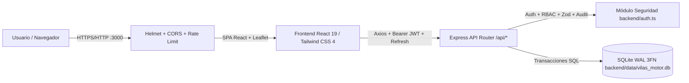
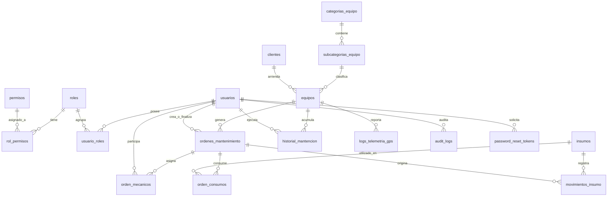

# Arquitectura del Sistema, Base de Datos (3FN) y Seguridad

## 1. Arquitectura General

El sistema opera bajo una arquitectura cliente-servidor unificada sobre **Node.js + Express 5**, sirviendo tanto la API REST (`/api/*`) como la aplicación SPA en **React 19 + TypeScript + Vite 8** en el puerto `3000`:

---

## 2. Diseño de Base de Datos Relacional (3FN)

La base de datos opera con `PRAGMA foreign_keys = ON` y modo `WAL` (*Write-Ahead Logging*) para lecturas concurrentes rápidas y escrituras atómicas.

### Cumplimiento de Normalización
* **1FN:** Todos los atributos son atómicos; los mecánicos asignados a una orden y los insumos consumidos se separan en tablas hijas (`orden_mecanicos` y `orden_consumos`) en lugar de columnas repetitivas o listas concatenadas.
* **2FN:** En tablas de relación muchos-a-muchos (`rol_permisos`, `usuario_roles`, `orden_consumos`), cada atributo no clave depende de la clave compuesta completa.
* **3FN:** Se eliminaron dependencias transitivas extrayendo `categorias_equipo` y `subcategorias_equipo` fuera de `equipos`, y derivando nombre/unidad de cada consumo desde `insumos` vía llave foránea `insumo_id`.

### Diagrama Entidad-Relación (DER)

### Diccionario Resumido de Tablas (18 tablas) e Índices (9 índices)

| Tabla | Propósito | Claves e Integridad |
| --- | --- | --- |
| `permisos`, `roles`, `rol_permisos` | Catálogo de permisos y roles RBAC | PKs, `UNIQUE(app_label, codename)`, `ON DELETE CASCADE` |
| `usuarios`, `usuario_roles` | Cuentas, hashes `scrypt` y asignación de roles | `email` / `username` `UNIQUE`, flags `CHECK (IN (0,1))` |
| `clientes` | Empresas contratantes | `rut UNIQUE`, `estado CHECK ('Activo','Inactivo')` |
| `categorias_equipo`, `subcategorias_equipo` | Taxonomía normalizada (3FN) | `FK categoria_id REFERENCES categorias_equipo(id)` |
| `equipos` | Flota de maquinarias, horómetros, GPS y estado | `codigo UNIQUE`, `FK subcategoria_id`, `FK cliente_empresa_id`, `CHECK >= 0` |
| `ordenes_mantenimiento` | Órdenes `Programada`, `En curso` y `Finalizada` | `FK equipo_id`, `FK creado_por_id`, `FK finalizado_por_id` |
| `orden_mecanicos` | Responsables asignados por orden | `FK orden_id ON DELETE CASCADE`, `FK usuario_id` |
| `insumos`, `orden_consumos`, `movimientos_insumo` | Stock, mínimos, consumo por OT y trazabilidad | `UNIQUE(orden_id, insumo_id)`, `CHECK (stock >= 0)`, `CHECK (cantidad > 0)` |
| `historial_mantencion` | Registro histórico de mantenciones finalizadas | `FK equipo_id`, `FK mecanico_responsable_id` |
| `logs_telemetria_gps` | Bitácora histórica de eventos GPS | `FK equipo_id`, `motor_encendido`, `sincronizado_offline` |
| `audit_logs` | Auditoría de seguridad y operaciones críticas | `FK usuario_id`, `accion`, `entidad`, `ip`, `fecha` |
| `password_reset_tokens` | Tokens temporales de recuperación de clave | `token PK`, `FK user_id ON DELETE CASCADE`, `expires_at` |

**Índices implementados para optimización:**
* `idx_equipos_estado_deleted` (`equipos(is_deleted, estado)`)
* `idx_equipos_cliente` (`equipos(cliente_empresa_id)`)
* `idx_equipos_subcategoria` (`equipos(subcategoria_id)`)
* `idx_ordenes_equipo_estado` (`ordenes_mantenimiento(equipo_id, estado)`)
* `idx_ordenes_fecha` (`ordenes_mantenimiento(fecha DESC, id DESC)`)
* `idx_historial_equipo_fecha` (`historial_mantencion(equipo_id, fecha_intervencion DESC)`)
* `idx_movimientos_fecha` (`movimientos_insumo(fecha DESC, id DESC)`)
* `idx_telemetria_equipo_ts` (`logs_telemetria_gps(equipo_id, timestamp_evento DESC)`)
* `idx_audit_fecha` (`audit_logs(fecha DESC)`)

---

## 3. Patrones de Seguridad Implementados

1. **Almacenamiento seguro de contraseñas:** Derivación con `crypto.scryptSync` (64 bytes) y `salt` aleatorio de 16 bytes por usuario, verificada mediante `crypto.timingSafeEqual` para mitigar ataques de temporización.
2. **Autenticación JWT de doble token:** `access` (2 h) y `refresh` (1 día) con validación estricta de `token_type` para impedir reutilizar tokens de acceso como tokens de refresco.
3. **Política robusta de contraseñas:** Mínimo 12 caracteres, rechazo de claves puramente numéricas y validación visual de complejidad en registro.
4. **Autorización RBAC multinivel:** Validación tanto en rutas protegidas de React como en middlewares Express (`requireAuth`, `requireAdmin`, `requirePermission`, `requireOperacionesPermission`).
5. **Protección de red y endpoints:** Cabeceras de seguridad `helmet`, control `cors`, limitación de tasa (`express-rate-limit`) en login/recuperación y validación con `zod`.
6. **Validación de archivos subidos:** Inspección binaria de *magic bytes* (`JPEG`, `PNG`, `WebP`) y límite estricto de `5 MB` en memoria con `multer`.
7. **Consultas SQL 100% parametrizadas:** Uso exclusivo de *prepared statements* en `node:sqlite`, inmune a inyección SQL.
8. **Trazabilidad en `audit_logs`:** Registro persistente de intentos de login exitosos/fallidos, cambios de usuarios/roles, bajas/restauraciones y cierre de mantenciones.

---

## 4. Catálogo Principal de Endpoints (`/api`)

| Módulo | Método y Ruta | Permiso / Rol |
| --- | --- | --- |
| Auth | `POST /api/login`, `POST /api/login/refresh`, `GET /api/perfil` | Público / Autenticado |
| Recuperación | `POST /api/contrasena/solicitar`, `POST /api/contrasena/restablecer` | Público (rate-limited) |
| Usuarios/RBAC | `GET/POST /api/registro`, `/api/admin/usuarios`, `/api/admin/roles`, `/api/admin/permisos` | `ADMIN` + permisos `auth.*` |
| Auditoría y BD | `GET /api/admin/auditoria`, `GET /api/admin/db-status` | `ADMIN` |
| Equipos | `GET/POST /api/equipos`, `GET/PATCH/PUT/DELETE /api/equipos/:id`, `POST /api/equipos/:id/restaurar` | `equipos.*_equipo` |
| Mantenciones | `GET/POST /api/ordenes`, `POST /api/ordenes/:id/iniciar`, `POST /api/ordenes/:id/finalizar`, `POST /api/equipos/:id/finalizar-mantenimiento`, `GET/POST /api/mantenciones` | `equipos.*_historialmantencion` |
| Clientes | `GET/POST /api/clientes`, `PATCH /api/clientes/:id` | `ADMIN`, `PLANIFICACION` (lectura `TECNICO`) |
| Insumos | `GET/POST /api/insumos`, `PATCH/DELETE /api/insumos/:id`, `POST /api/insumos/:id/ajustar`, `GET /api/movimientos-insumos` | `ADMIN`, `PLANIFICACION` (lectura `TECNICO`) |
| Telemetría | `GET /api/telemetria` | `equipos.view_logtelemetriagps` |
